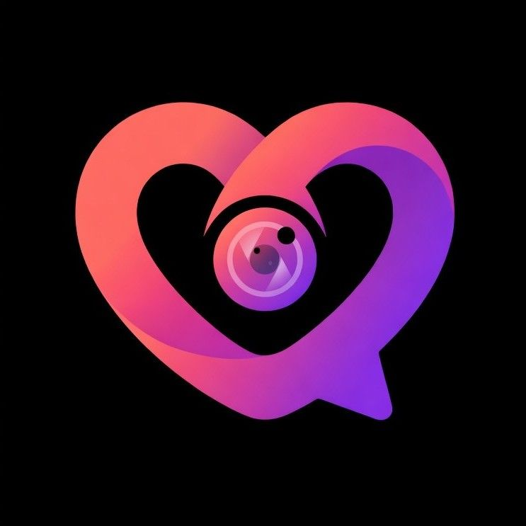

# 🔥 oyecam — Live Video Social & Dating Platform

<div align="center">



**A little hello. A real connection.**  
Spontaneous 1-on-1 video calls, vibrant creator live streams, and authentic social discovery built for the next generation.

[](https://reactjs.org/)
[](https://vitejs.dev/)
[](https://vercel.com/)
[](#-legal--compliance-suite)
[](#-security--privacy-architecture)

[Features](#-key-features) • [Legal & Compliance](#-legal--compliance-suite) • [Contact Us](#-contact--support-desk) • [Vercel Deployment](#-vercel-deployment-guide) • [Project Architecture](#-project-architecture) • [Getting Started](#-getting-started)

</div>

---

## ✨ Key Features

- **⚡ Spontaneous 1-on-1 HD Video Sparks:** Direct WebRTC peer-to-peer real-time video streaming with ultra-low latency.
- **🛡️ Zero Call Storage / Screen Privacy:** Private 1-on-1 calls are never recorded, archived, or stored in the cloud.
- **🎤 Vibrant Creator Live Rooms:** Community broadcasting with multi-guest audio/video seating and animated virtual gifting.
- **🪙 Secure In-App Coin Economy:** Virtual wallet mechanics for tipping performers and unlocking premium rooms with Google Play & App Store billing standards.
- **✨ Verified 18+ Community:** Strict age verification safeguards, automated AI content moderation, and 1-tap in-call reporting.
- **🎨 Glassmorphic Cyberpunk UI:** Tailored dark aesthetic with Framer Motion transitions, responsive particle canvas, and interactive micro-animations.

---

## ⚖️ Legal & Compliance Suite

oyecam includes a production-grade, legally sound compliance hub tailored to Indian and international digital platform standards (including the **Digital Personal Data Protection Act, 2023** and the **Information Technology Act, 2000**).

All legal pages feature a unified glassmorphism header toolbar with a quick tab switcher and back navigation:

| Page | Route | Description & Highlights |
| :--- | :--- | :--- |
| **Privacy Policy** | `#/privacy` | Complete data collection breakdown, camera/mic permission disclosure, zero ad-broker sales, retention timelines, and statutory Grievance Officer details. |
| **Terms of Service** | `#/terms` | Mandatory 18+ age verification requirement, strict code of conduct, virtual coin licensing and refund terms, limitation of liability, and jurisdiction (New Delhi). |
| **Cookie Policy** | `#/cookie-policy` | Transparent cookie usage breakdown: Strictly necessary session tokens, media state preferences, zero cross-site ad tracking, and step-by-step browser opt-out guides. |
| **Community Guidelines** | `#/community-guidelines` | Clear community standards: 4 zero-tolerance violations (harassment, unauthorized recording, explicit content, hate speech), strike escalation ladder, and host responsibilities. |
| **Contact Us** | `#/contact` | 4 direct support channels, 24/7 ticket generation system (`#OYE-XXXXXX`), verified office address, direct phone helpline, and interactive FAQ accordion. |
| **Delete Account** | `#/delete-account` | Self-serve web data deletion portal allowing users to request permanent removal of account records and stored profile assets. |

---

## 📞 Contact & Support Desk

| Channel | Details | Availability |
| :--- | :--- | :--- |
| **Direct Phone Helpline** | **+91 90101 87125** | Mon – Sat (9:00 AM – 8:00 PM IST) |
| **Online Help Desk** | **Interactive Web Support Portal** (`#/contact`) | 24/7 Priority Ticket Dispatch |
| **Trust & Safety Escalations** | **Direct Phone Helpline: +91 90101 87125** | Priority Escalation |
| **Registered Corporate Office** | **1-41 Vivek Nagar Colony, Jillelaguda, Pincode - 500097** | Telangana / India |

---

## 🚀 Vercel Deployment Guide

The repository includes a ready-to-deploy `vercel.json` optimized for Single-Page Application (SPA) routing, performance, and security.

### `vercel.json` Configuration

```json
{
  "framework": "vite",
  "cleanUrls": true,
  "rewrites": [
    {
      "source": "/(.*)",
      "destination": "/index.html"
    }
  ],
  "headers": [
    {
      "source": "/(.*)",
      "headers": [
        { "key": "X-Content-Type-Options", "value": "nosniff" },
        { "key": "X-Frame-Options", "value": "SAMEORIGIN" },
        { "key": "X-XSS-Protection", "value": "1; mode=block" },
        { "key": "Referrer-Policy", "value": "strict-origin-when-cross-origin" }
      ]
    },
    {
      "source": "/assets/(.*)",
      "headers": [
        { "key": "Cache-Control", "value": "public, max-age=31536000, immutable" }
      ]
    }
  ]
}
```

### Deploying to Vercel

#### Method 1: Via Vercel CLI
```bash
# Install Vercel CLI (if not already installed)
npm i -g vercel

# Deploy directly from repository root
vercel
```

#### Method 2: Via Git (GitHub / GitLab / Bitbucket)
1. Push this repository to GitHub.
2. In your Vercel Dashboard, click **Add New > Project** and import the repository.
3. Vercel automatically detects the **Vite** framework preset:
   - **Build Command:** `npm run build`
   - **Output Directory:** `dist`
   - **Install Command:** `npm install`
4. Click **Deploy**. Vercel will build and serve your site globally with zero 404 routing errors on page refreshes!

---

## 📁 Project Architecture

The codebase follows a clean, modular structure:

```
dating app landing page/
├── docs/
│   └── reference-assets/        # Original mockup screenshots & reference assets
├── public/
│   ├── couples/                 # Real user success story photography
│   ├── feature/                 # Feature section high-res renders
│   ├── people/                  # High-quality AI community profile photos
│   ├── screens/                 # Mobile app interface previews
│   ├── slides/                  # Carousel & showcase graphics
│   ├── favicon.svg              # SVG branding favicon
│   └── logo.jpeg                # Brand badge icon
├── src/
│   ├── components/
│   │   └── LegalLayout.jsx      # Reusable top navigation toolbar & tab switcher
│   ├── pages/
│   │   ├── CommunityGuidelines.jsx # Safety standards, etiquette & strike rules
│   │   ├── ContactUs.jsx        # 4 contact channels, ticket form & FAQs
│   │   ├── CookiePolicy.jsx     # Comprehensive cookie classification & DPDP rules
│   │   ├── DeleteAccount.jsx    # Self-serve account deletion workflow
│   │   ├── PrivacyPolicy.jsx    # DPDP 2023 & IT Act data protection policy
│   │   └── TermsConditions.jsx  # 18+ terms of service & virtual coin licensing
│   ├── legal.css                # Polished styling for all legal & contact pages
│   ├── main.jsx                 # Main application, router, state & UI sections
│   └── styles.css               # Core design system tokens, typography & animations
├── index.html                   # HTML5 entry with meta tags & SEO configuration
├── package.json                 # Project dependencies & npm scripts
├── vercel.json                  # Vercel SPA rewrites, security headers & caching
└── vite.config.js               # Vite configuration & build optimization
```

---

## 🛠️ Getting Started

### Prerequisites

- **Node.js** (v18.0.0 or later recommended)
- **npm** or **yarn** / **pnpm**

### Installation

```bash
# 1. Clone the repository
git clone <repository-url>

# 2. Navigate to project root
cd "dating app landing page"

# 3. Install dependencies
npm install

# 4. Start local development server
npm run dev
```

Visit `http://localhost:5173` in your browser.

### Building for Production

```bash
# Build production bundle into /dist
npm run build

# Preview production build locally
npm run preview
```

---

## 🔒 Security & Privacy Architecture

- **WebRTC Direct Signaling:** Encrypted media channels ensure private peer-to-peer 1-on-1 calls remain untracked and unrecorded.
- **Strict 18+ Age Wall:** Underage access strictly prohibited, with automated account freezing and immediate escalation upon violation.
- **Protection Against Non-Consensual Recording:** Client-level screenshot deterrents and active room moderation.
- **Grievance Redressal Mechanism:** Designated compliance officer in accordance with the Information Technology (Intermediary Guidelines and Digital Media Ethics Code) Rules, 2021.

---

<div align="center">

Made with ❤️ in India • **© 2026 oyecam Technologies Private Limited. All rights reserved.**

</div>
